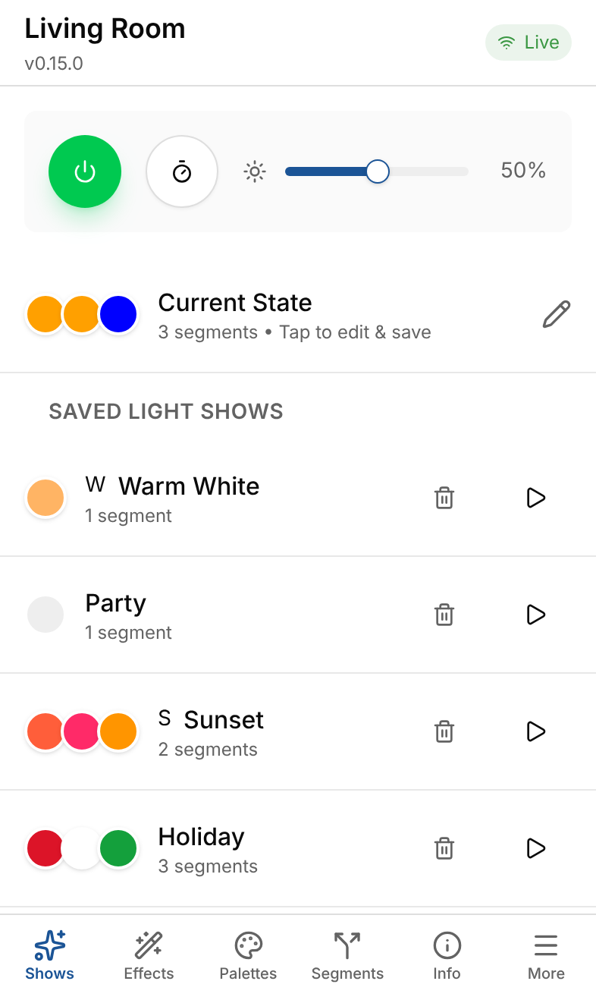
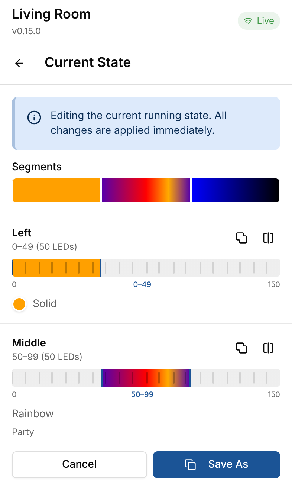
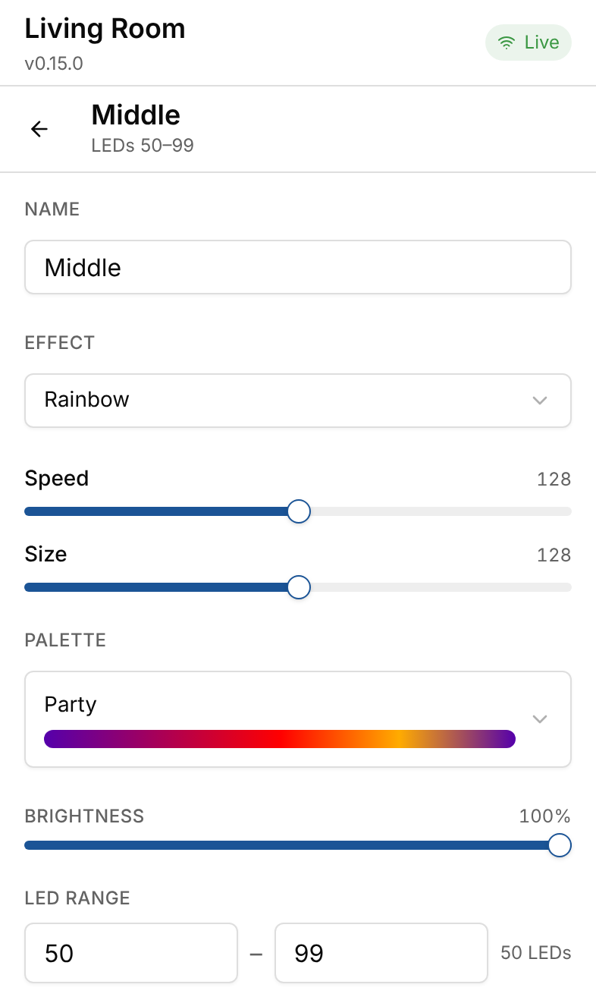
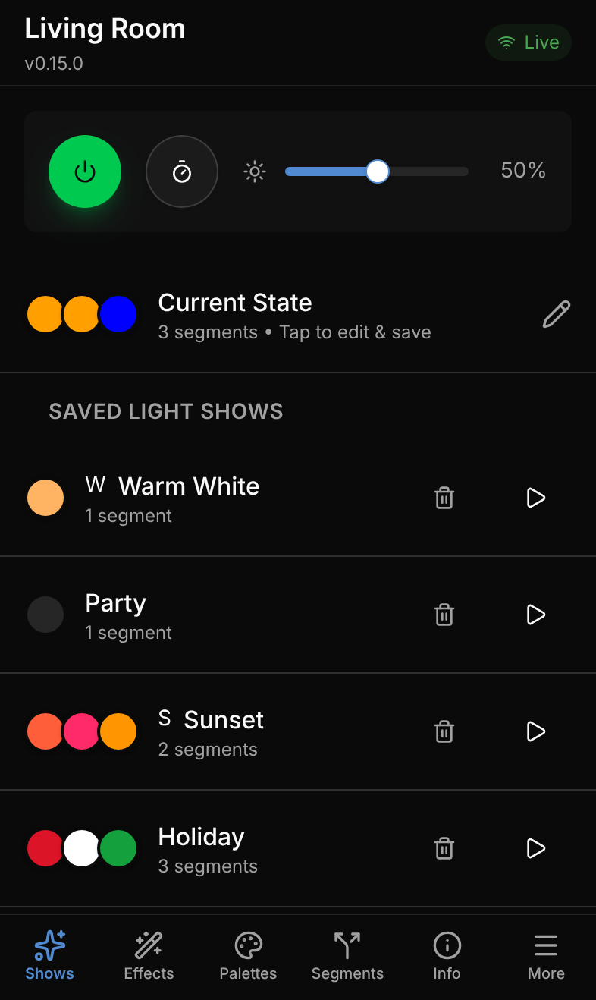
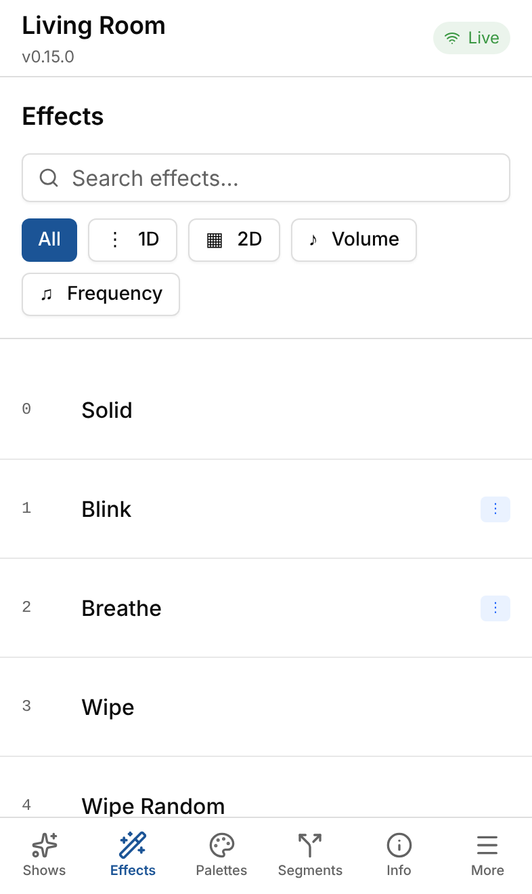
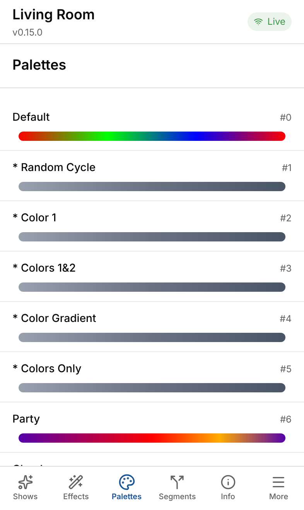
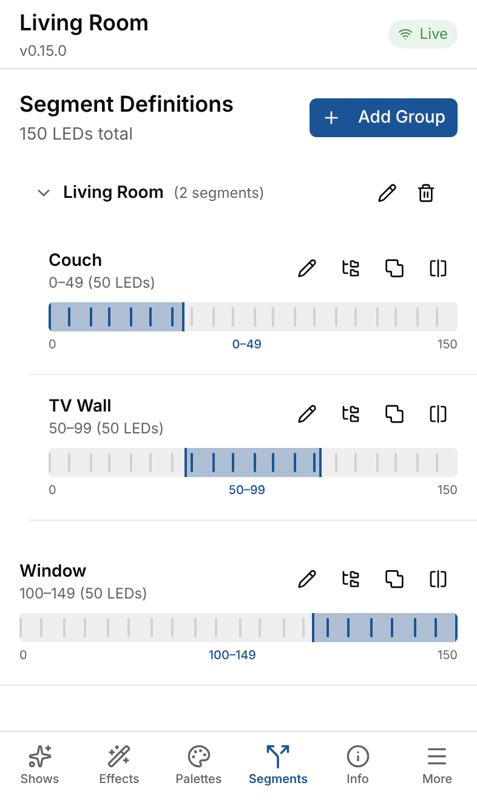
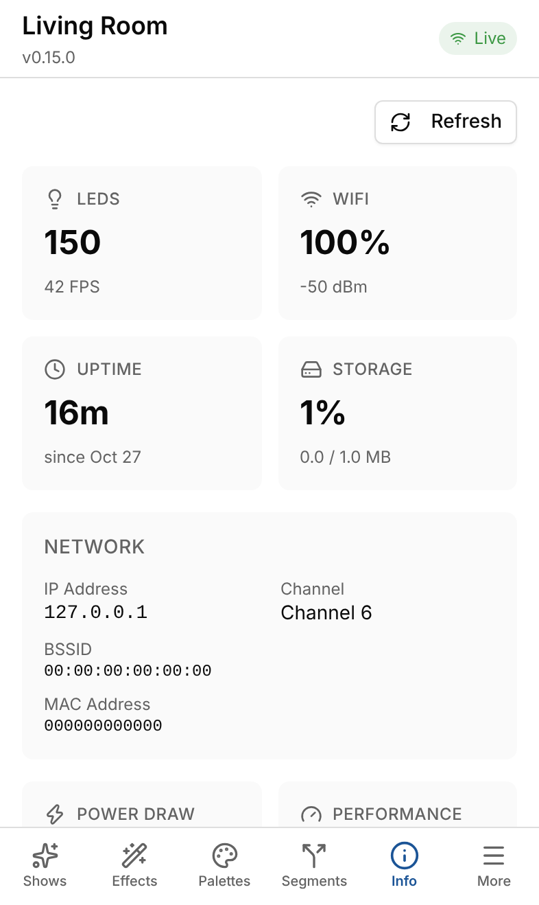

# WLED Pro

A modern, mobile-first app for [WLED](https://kno.wled.ge) LED controllers. WLED Pro talks
to your controllers over WLED's JSON API and WebSocket, and gives you a phone-friendly way
to build light shows, carve a strip into zones, browse effects and palettes, and manage
device settings. It installs as a Progressive Web App, so it sits on your home screen like
a native app.

WLED Pro is an independent front end. All the hard work of driving LEDs is done by
[WLED](https://github.com/wled/WLED) running on your ESP8266/ESP32; see
[Credits](#credits).

<p align="center">
  
  
  
  
</p>

## Features

### Light shows (presets)

- Power, brightness and sleep timer up front, synced live with the device over WebSocket
- Play, edit and delete saved presets, with quick-load labels
- Visual show editor: tap a segment in the strip preview to change its effect, colors,
  palette, speed, intensity and LED range
- Split, merge and name segments, and turn gaps between segments into new ones
- Edit the running state directly, or edit a preset with an optional live preview on the
  device; Cancel puts the device back the way it was
- Save or Save As writes the segments and the preset in one request

### Global segments

- Define your physical layout once ("Couch", "TV Wall", "Window"), grouped by room
- Apply a layout to any light show to split it into matching WLED segments
- Stored on the controller itself (`/wled-pro-segments.json`), so every phone sees the same
  layout

### Effects and palettes

- Searchable effect browser with 1D, 2D and audio-reactive filters
- The editor only shows the colors, sliders and options an effect actually uses (from
  WLED's effect metadata)
- Palette previews rendered from the device's real gradients

### Device settings

- WiFi, LED hardware (strips, pins, power budget), time and location, sync, security
- Schedules, playlists and sleep timer
- Device info: LEDs, FPS, WiFi signal, uptime, storage, power draw

### App

- Manage several controllers and switch between them
- Six themes (light, dark, neon, cyberpunk, sunset, ocean)
- Installable PWA with offline support for the app itself

<p align="center">
  
  
  
  
</p>

## Getting started

You need a WLED controller on your network and [Bun](https://bun.sh) to build the app.

```bash
git clone https://github.com/alecf/wled-pro.git
cd wled-pro
bun install
bun run dev --host   # serve on your LAN so your phone can reach it
```

Open the printed address on your phone, tap **Add Controller** and enter your WLED
device's IP address or hostname (for example `192.168.1.50` or `wled-livingroom.local`).

To keep it running, build it once and serve the `dist/` folder from any static web server
on your network:

```bash
bun run build
bun run preview --host   # or copy dist/ to your own web server
```

**Use HTTP on your local network.** WLED controllers only speak plain HTTP, and browsers
restrict what an HTTPS page can do with an HTTP device: WebSockets are blocked outright
(WLED Pro falls back to polling), and many browsers block the HTTP requests too. Serving
WLED Pro over HTTP from your own network avoids both.

## Development

This project uses [Bun](https://bun.sh) as its package manager and script runner; Vite,
Vitest and Playwright run on Node (see `engines` in `package.json`).

```bash
bun run dev             # Start the dev server
bun run test            # Unit and integration tests (Vitest, watch mode)
bun run test:e2e        # End-to-end tests (Playwright)
bun run lint            # Biome lint and format check
bun run build           # Production build and TypeScript typecheck
bun run screenshots     # Regenerate docs/screenshots/ against the fake device
```

**No hardware needed.** The repo includes a stateful fake WLED device (HTTP JSON API,
WebSocket, presets and file uploads) that the tests run against. To use it while
developing:

```bash
bun scripts/fake-wled.ts --port 8787
bun run dev   # then add http://127.0.0.1:8787 as a controller
```

See [docs/testing.md](docs/testing.md) for details, and [AGENTS.md](AGENTS.md) for the
architecture, conventions and WLED vocabulary. Notes on WLED's JSON API, including the
quirks the app depends on, are in [docs/wled-api/](docs/wled-api/).

### Tech stack

React 19, TypeScript, Vite, TanStack Router and React Query, Tailwind CSS v4 with
shadcn/ui, Vitest and Testing Library, Playwright, Biome, and vite-plugin-pwa.

## Credits

WLED Pro exists because of [WLED](https://github.com/wled/WLED), the open source firmware
created by Aircoookie (Christian Schwinne) and developed by a large community of
contributors. WLED does the real work: the effects engine, the palettes, segments,
presets, playlists, sync, and the JSON API this app is built on. Its
[documentation](https://kno.wled.ge) made this project possible.

If WLED lights up your home, consider supporting the WLED project and its contributors.
WLED Pro is not affiliated with or endorsed by the WLED project.
